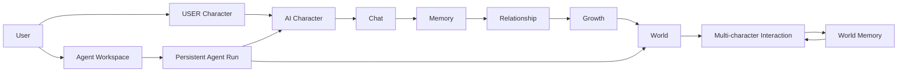
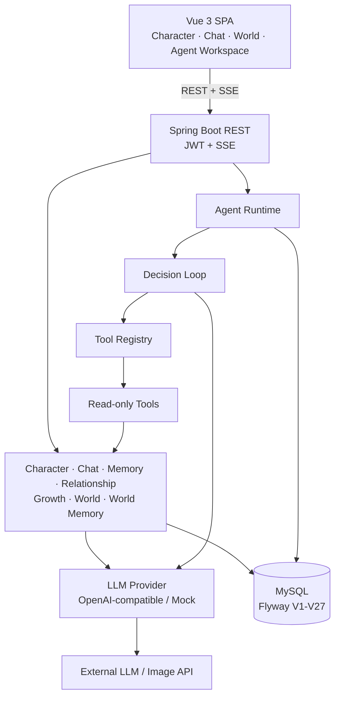
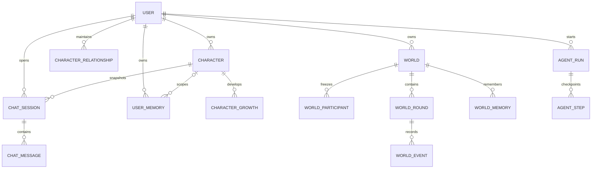

[中文](README.md) | [English](README_EN.md)

# AI Character World

**围绕持久化 AI Character 构建的角色互动平台。**

AI Character World 通过长期记忆、关系状态、成长机制与持久化 World，让 AI Character 在不同会话和多角色场景中保持连续性。项目重点不只是调用 Chat Completions API，而是围绕 AI 交互处理身份快照、状态演进、并发一致性、失败隔离与中断恢复。

**技术栈：** Java 17 · Spring Boot 3.2 · MyBatis-Plus · Flyway · MySQL · Vue 3 · Pinia · Vite · OpenAI-compatible LLM API

## 项目简介

普通 Chatbot 通常以当前对话为边界；本项目将对话放入长期存在的角色系统中。Character Identity 被持久化，相关记忆会进入后续 Prompt，Relationship 与 Growth 可以逐步变化，完成的 World Interaction 还会沉淀为后续 Round 可复用的 World Memory。历史记录使用创建时的 Snapshot，不会随当前 Character 或 World 的编辑而漂移。

## 核心体验



## 核心功能

### Character System

- 管理用户所有的 USER / AI Character，包含身份、性格、目标、经历、说话方式、结构化档案与视觉信息。
- 将 USER Character 绑定为用户身份；AI Character 用于一对一 Chat 和 World Participant。
- 支持将自然语言描述解析为可编辑草稿，以及带显式确认步骤的 Character Image 生成。

### AI Chat

- 持久化 Session 与 Message，通过 SSE 流式返回回复。
- 使用客户端 request ID 和数据库唯一约束保证提交幂等；支持停止、重试、状态同步和服务中断后的消息恢复。
- Prompt 由冻结的 Character Snapshot、受限对话历史、Memory、Relationship 和 Growth 共同组成。

### Long-term Memory

- 回复完成后执行结构化 LLM 记忆提取，并提供规则提取回退。
- 同时支持全局用户记忆与 Character-scoped Memory；检索时只合并全局记忆和当前 AI Character 的记忆。
- 按相关性、作用域、重要度、时间和稳定次序进行有界排序。

### Relationship 与 Character Growth

- 每个 User × AI Character 保存一份 Relationship 和 Growth 状态。
- Relationship 由 LLM 根据互动质量评估，而不是按消息数量机械升级；结果会影响后续 Prompt。
- Growth 记录行为适应、用户理解和成长方向，但不会覆盖 Character 的核心身份。
- 两类状态均使用 version + CAS 更新和有限重试处理并发冲突。

### World 与 Multi-character Interaction

- 创建用户所有的 World，配置背景、规则、氛围、场景、USER Character 身份，以及 2–4 个有序 AI Participant。
- 按顺序执行 AI Participant，使后续角色可以看到同一 Round 中已成功的发言。
- 持久化 World Round 与有序 Event，支持 timeline、partial failure 和前端轮询恢复。
- Participant 在加入时冻结 Snapshot；产生互动记录后锁定阵容，避免历史身份变化。

### World Memory

- 在成功完成 Round 后提取事实、角色发展、关系、事件和未解决线索等结构化记忆。
- 按 User 和 World 隔离存储，使用稳定哈希去重，并通过乐观锁合并 keyed memory。
- 新记忆要求本轮已完成 Event 的 ID 与原文证据；USER/AI 叙述的世界行动均可作为来源，计划、疑问与传闻不能直接升级成已完成事件。模型摘要保留作检索/合并线索，不是独立核验的事实；后续 Prompt 只注入核验过的来源引文和计划/未证实标记。历史无来源记录保持原有读取行为，不自动清洗。
- 检索相关且有界的 World Memory 注入下一轮 Prompt，并使用 Round 创建时的 Frozen World Snapshot 保持历史语义。
- Round 的终态先提交，再在执行线程中进行记忆后处理；`COMPLETED` 不表示记忆已完成。按资源 ID 观察 `WORLD_MEMORY_STARTED` / `WORLD_MEMORY_COMPLETED` / `WORLD_MEMORY_FAILED` 日志；成功的空提取也有完成日志。日志不包含对话正文、Provider 错误正文或凭证。
- 后处理期间的下一轮使用当时已提交的记忆及本轮成功发言，不等待上一轮提取；旧 Round 的迟到 keyed 更新不能覆盖更新 Round 的同 key 状态。后处理不是持久任务：终态提交后崩溃可能遗漏提取，目前没有自动补偿；不能把没有完成日志直接解释为空结果。
- 执行中重启后，RUNNING Round 的 5 分钟租约仍有效时只观察；过期后可通过“恢复执行”或重新进入页面接管。已经保存的参与角色 Event 不重生成，未保存的角色请求可能重发；不保证 Provider 停止计算或避免费用。

### Agent Runtime

- 从用户 Goal 创建持久化 Agent Run，由 LLM 在每一步严格选择 `TOOL_CALL` 或 `FINAL`，并将 Decision、Tool Result、错误与最终结果写入 Agent Run / Agent Step。
- 使用 `MAX_STEPS` 限制执行闭环；LLM 合约错误和可重试 Provider 错误共享有界 Decision attempt，Tool 执行也有 timeout、retry 与持久化 attempt budget。
- 支持 checkpoint / resume、基于 `executionVersion` 的 fencing、request ID 幂等，以及同一 Run 内已完成 Tool 调用的 canonical arguments 去重与结果复用。
- 当前 Tool 全部只读：`get_character_context` 读取 Character context，`search_character_memory` 检索 Character-scoped memory，`get_world_context` 读取 World context。

### Agent Workspace

- 提供独立的目标执行页面，可创建 Agent Run，并通过有界轮询实时刷新状态、Step 和最终结果。
- Recent Runs 保存执行入口；URL 中的 `runId` 支持刷新后恢复当前 Run，切换 Run 时使用 generation fencing 防止旧响应覆盖新选择。
- Step Timeline 以 Decision、Action、Observation 和 Result 展示 `TOOL_CALL`、`DUPLICATE_TOOL_CALL`、`FINAL` 与失败状态，不展示隐藏推理或 chain-of-thought。
- Step Detail 结构化展示只读 Tool、arguments、observation、attempt/retry 和时间信息；长内容可安全折叠，非法 JSON 回退为普通文本。
- 支持 terminal result、错误详情与后端授权的 checkpoint resume；桌面端使用三栏工作区，移动端使用 Step Detail Drawer。

```text
Goal
  ↓
LLM Decision
  ↓
TOOL_CALL / FINAL
  ↓
Tool Registry
  ↓
Read-only Java Tool
  ↓
Persist Tool Result
  ↓
Next Decision
  ↓
FINAL
```

每一步都会持久化到 Agent Run / Agent Step，因此中断后的执行可以从 checkpoint 恢复，而不需要重放已经完成的 Tool。

### 可靠性与安全

- 使用 JWT、BCrypt 与持久化 Auth Session，实现无状态认证和 token revocation。
- Service 查询对 Character、Chat、Memory、World、Round 和生成图片执行 ownership 校验。
- MyBatis-Plus soft delete、LLM 启动配置校验、独立 AI usage 记录，以及图片路径/下载安全检查。

## 系统架构



后端是 modular monolith，统一负责认证、业务编排、状态持久化、Agent Runtime 和外部 AI 集成。LLM Provider 同时服务现有 AI 能力与 Agent Decision。当前实现不包含微服务、消息队列、向量数据库、Multi-Agent、自治写入 Tool 或长期调度器。

## 工程亮点

1. **Frozen Character Snapshot：** Chat Session 和 World Participant 保存版本化 JSON，使历史身份、图片和性格不受源 Character 后续修改或删除影响。
2. **Character-scoped Memory：** `user_id + optional character_id` 明确记忆边界，避免不同 AI Character 之间串线。
3. **Relationship CAS：** 质化关系状态持久化后参与 Prompt；version 条件更新避免并发写覆盖。
4. **Identity-safe Growth：** Growth 作为额外适应层存在，不修改冻结的核心 Character Identity。
5. **Round / Event persistence：** Round 与首个用户 Event 原子创建，LLM 调用之外逐条持久化 AI Event，可重建 timeline 并保留部分成功结果。
6. **Frozen World Snapshot：** 每个 Round 保存创建时的 World 语义，后续 World 修改不会重写历史上下文。
7. **Persistent World Memory：** 完成的 Round 被提取为 typed memory，通过 hash 去重、keyed consolidation 和相关性检索延续到下一轮。
8. **Lease + fencing recovery：** 过期 `RUNNING` Round 可被重新 claim；递增 `execution_version` 阻止旧 worker 在失去执行权后继续写入。
9. **Failure isolation：** Chat 回复完成后，Memory、Relationship、Growth 分别执行并独立捕获失败；World Memory 提取失败也不回滚已完成 Round。
10. **短事务边界：** 外部 LLM 调用不处于长数据库事务或锁中；World lifecycle 使用独立短事务。
11. **Ownership security：** 核心资源均按认证用户查询，配合 JWT、唯一约束、soft delete 与迁移级索引形成数据边界。
12. **Persistent Agent Runtime：** Goal、Decision、Tool attempt 与结果按 Step 持久化；checkpoint、fencing、幂等和 completed-call guard 共同保证恢复与重复执行安全。
13. **Agent execution UI：** Recent Runs、轮询、Timeline、Step Detail、错误与 Resume 状态使用真实 backend DTO，且用户主动查看旧 Step 时不会被后续轮询抢走选择。

## 技术栈

| 范围 | 已验证技术 |
| --- | --- |
| Backend | Java 17, Spring Boot 3.2.5, Spring MVC, Security, Validation, Reactor Core |
| Persistence | MyBatis-Plus 3.5.5, Flyway, MySQL Connector/J, HikariCP |
| AI | OpenAI-compatible / Mock provider, SSE, structured JSON, prompt templates, OkHttp 4.12 |
| Frontend | Vue 3.4, Vue Router 4.3, Pinia 2.1, Element Plus 2.6, Axios 1.6, Vite 5.x, Sass |
| Testing | JUnit 5, Spring Boot Test, Mockito, H2, Node.js test runner |

仓库保留 Spring Data Redis 依赖及相关类，但 Redis 默认关闭且不是当前本地运行的硬依赖。

## 数据模型



Flyway `V1`–`V27` 覆盖基础模型、soft delete、消息生命周期、Character、World、执行恢复、Character-scoped Memory、Relationship、Growth、World Memory、Frozen World Snapshot，以及 V27 的 persistent Agent Run / Agent Step runtime。

## 项目结构

```text
ai-character-world/
├── backend/   # Spring Boot API、domain、security、Flyway、tests
├── frontend/  # Vue views、Pinia stores、API clients、tests
├── scripts/   # image acceptance helpers
├── README.md
└── README_EN.md
```

## 快速开始

本地核心使用不要求公网部署。前置条件为 Java 17、Maven、Node.js/npm、MySQL；Redis 默认禁用，图片 Provider 为可选项。实测版本和完整配置顺序见 [本地运行与配置](docs/LOCAL_RUN.md)。

1. 准备自己命名的 MySQL 空库及有该库权限的账号；默认端口3307。首次验收不要使用日常数据。
2. 按 [`.env.example`](.env.example) 的键名在后端进程提供 `DB_*`、`JWT_SECRET`、`AI_*`。该示例不会自动加载，也不含秘密。
3. 显式设置 `SPRING_PROFILES_ACTIVE=local-real`、`AI_PROVIDER=openai-compatible`、`AI_MOCK_ENABLED=false`。完整 Provider URL 须含 `/chat/completions`；`LLM_*` 不会自动映射。不要将真实值写进命令历史或 Git。
4. 后端终端执行：

```powershell
cd backend
mvn spring-boot:run
# http://localhost:8080
```

5. 第二个终端执行：

```powershell
cd frontend
npm ci
npm run dev
# http://localhost:5173；/api 与 /generated-images 代理到8080
```

Flyway 会在启动时自动校验／迁移；缺 AI 配置失败不意味着数据库未被迁移。推荐 `SPRING_FLYWAY_BASELINE_ON_MIGRATE=false`，不修改已执行迁移。`local-real` 不需要额外 profile 文件，可避免加载本机 `dev` 覆盖配置。Mock 可用于开发，但不证明真实 AI 可用；切换、停止和同库重启详见运行说明。

日常顺序见 [使用／演示指南](docs/USER_GUIDE.md)。第一次从角色进入聊天、或刷新页面后，可能需在左侧选择会话。图片默认保存到后端工作目录下的 `generated-images/`，可用 `IMAGE_STORAGE_DIRECTORY` 固定位置。

## 验收与已知限制

[当前验收摘要](docs/ACCEPTANCE_STATUS.md)是验证方式、对应版本和最终候选测试成绩的单一索引；[已知限制与待办](docs/KNOWN_LIMITATIONS.md)区分阻断、正确性、体验和未验证事项。历史测试数字不代表当前源码实测。

角色记忆的提取值采用原文片段，当前不支持任意自由概括；明确疑问、假设、小说台词、计划和猜测有保守过滤。World 可保留摘要作检索线索，但后续事实 Prompt 仅使用带来源与限定语的核验引文。来源约束不等于语义真值，也不自动清洗旧错误记忆。关系／成长按有意义证据评估，不保证每轮变化。

聊天停止／刷新可能延迟确认，不保存未完成片段，也不保证停止 Provider 计费。World 的 Round 完成早于记忆后处理，后处理无崩溃自动补偿。Agent 只读且有步数／尝试上限；恢复只支持后端允许的检查点。历史库升级和真实 Provider 崩溃恢复不因其他场景通过而自动成为已验证。

## 测试

```powershell
cd backend
mvn test
cd ../frontend
npm test
npm run build
```

后端测试强制 H2 内存隔离并关闭 Flyway；构建的 Sass／大分块警告当前不是功能阻断。具体本轮成绩与历史区别见验收摘要。

## 技术说明

仓库仍保留少量历史 Three.js / VRM 兼容代码和两个 VRM 资源，但现阶段产品方向以 Character Image 与 UI 交互为主，3D 并非核心体验。

## 后续规划

以下内容尚未实现，仅作为规划：

- World Image Generation
- 将 Agent Workspace 的浅色视觉语言逐步统一到 Character、World 与 Chat
- UI/UX 细节优化与项目截图整理
- CI
- Docker 与部署加固
- 端到端回归完善
