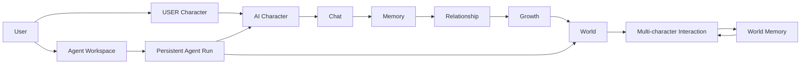
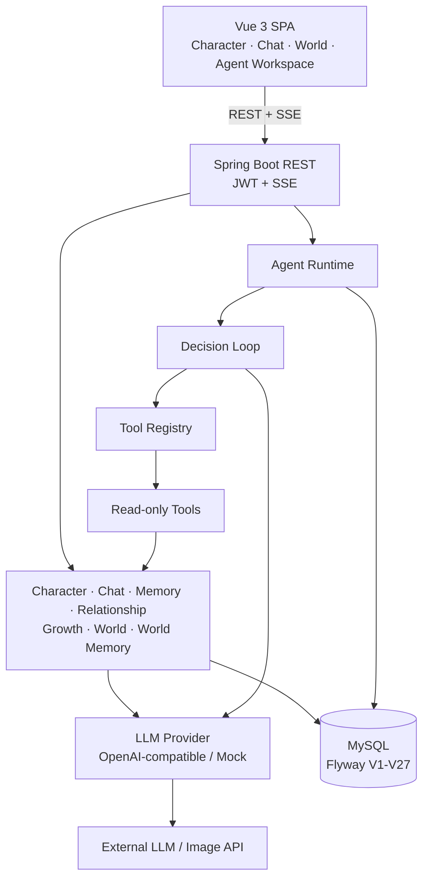
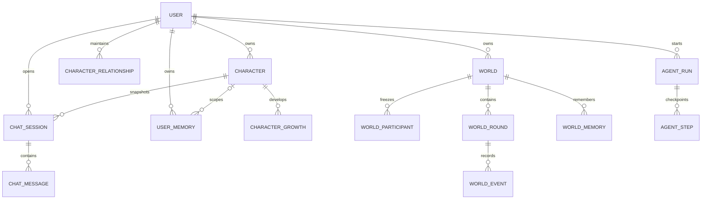

[中文](README.md) | [English](README_EN.md)

# AI Character World

**A stateful interaction platform built around persistent AI characters.**

AI Character World combines long-term memory, relationship state, adaptive growth, and persistent worlds so characters retain continuity across conversations and multi-character scenarios. The engineering focus extends beyond a chat-completions call to identity snapshots, state evolution, concurrency control, failure isolation, and interrupted-execution recovery.

**Stack:** Java 17 · Spring Boot 3.2 · MyBatis-Plus · Flyway · MySQL · Vue 3 · Pinia · Vite · OpenAI-compatible LLM API

## Overview

Most chatbots treat the current conversation as the product boundary. This project places chat inside a persistent character system: identity is stored, relevant memory returns to later prompts, relationship and growth state can evolve, and completed world interactions become reusable context. Historical records use creation-time snapshots and do not drift when a live character or world changes.

## Core Experience



## Features

### Character System

- Manage user-owned USER and AI characters with identity, personality, goals, biography, speaking style, structured profile data, and visual metadata.
- Bind a USER character as the user's identity; use AI characters in one-to-one chat and as world participants.
- Parse natural-language descriptions into editable drafts and generate character-image candidates through an explicit confirmation flow.

### AI Chat

- Persist sessions and messages while streaming assistant output over SSE.
- Use client request IDs and database uniqueness for idempotency; support stop, retry, synchronization, and recovery of interrupted message lifecycles.
- Compose prompts from frozen character identity, bounded history, memory, relationship state, and growth context.

### Long-term Memory

- Run structured LLM extraction after completed responses with a rule-based fallback.
- Store global user memory and character-scoped memory; retrieval combines only global and current-character records.
- Rank a bounded candidate set by relevance, scope, importance, recency, and stable tie-breakers.

### Relationship and Character Growth

- Keep one relationship and one growth record per user-character pair.
- Evaluate qualitative relationship changes instead of promoting stages from a message counter, then feed the state into later prompts.
- Model growth as a supplemental adaptation layer that cannot overwrite frozen core identity.
- Persist both domains with versioned CAS updates and bounded conflict retries.

### World and Multi-character Interaction

- Create user-owned worlds with semantic fields, a USER character identity, and an ordered roster of two to four AI participants.
- Execute participants sequentially so later actors can observe earlier successful speeches in the same round.
- Persist rounds and ordered events with timeline, partial-failure, and frontend polling recovery support.
- Freeze participant snapshots and lock roster replacement once interaction history exists.

### World Memory

- Extract structured facts, character developments, relationships, events, and unresolved threads after a successful round.
- Scope records by user and world, deduplicate with stable hashes, and consolidate keyed memory through optimistic updates.
- Retrieve bounded relevant memory for the next round and use the round's frozen world snapshot to preserve historical meaning.

### Agent Runtime

- Create a persistent Agent Run from a user goal. At each step, the LLM must choose a strict `TOOL_CALL` or `FINAL` decision, while decisions, tool results, errors, and the final result are stored in Agent Run / Agent Step records.
- Bound the loop with `MAX_STEPS`. Contract-invalid decisions and retryable provider failures share a bounded decision-attempt budget, while tool execution has its own timeout, retry, and persisted attempt budget.
- Support checkpoint / resume, `executionVersion` fencing, request-ID idempotency, and canonical-argument deduplication with result reuse for completed tool calls within the same run.
- All current tools are read-only: `get_character_context` reads character context, `search_character_memory` retrieves character-scoped memory, and `get_world_context` reads world context.

### Agent Workspace

- Provides a dedicated goal-execution page that creates Agent Runs and refreshes status, steps, and final results through bounded polling.
- Recent Runs preserve navigation, while a URL `runId` restores the selected Run after refresh. Generation fencing prevents stale responses from overwriting a newly selected Run.
- The Step Timeline presents decisions, actions, observations, and results for `TOOL_CALL`, `DUPLICATE_TOOL_CALL`, `FINAL`, and failure states without exposing hidden reasoning or chain-of-thought.
- Step Detail renders read-only tools, arguments, observations, attempt/retry metadata, and timestamps as structured content; long payloads are collapsible and invalid JSON safely falls back to text.
- The workspace supports terminal results, failure details, and backend-authorized checkpoint resume, with a desktop three-column layout and a mobile Step Detail drawer.

```text
Goal
  ↓
LLM Decision
  ↓
TOOL_CALL / FINAL
  ↓
Tool Registry
  ↓
Read-only Java Tool
  ↓
Persist Tool Result
  ↓
Next Decision
  ↓
FINAL
```

Every step is persisted to Agent Run / Agent Step, so interrupted execution can resume from a checkpoint without replaying already completed tools.

### Reliability and Security

- Use JWT, BCrypt, and persisted auth sessions for stateless authentication and token revocation.
- Enforce ownership for characters, chats, memories, worlds, rounds, and generated images.
- Apply MyBatis-Plus soft deletion, startup LLM validation, separate AI usage records, and generated-image path/download safeguards.

## Architecture



The backend is a modular monolith that owns authentication, orchestration, domain persistence, the Agent Runtime, and external AI integration. The LLM provider serves both the existing AI features and Agent decisions. The current implementation has no microservices, message broker, vector database, multi-agent system, autonomous write tools, or long-running scheduler.

## Engineering Highlights

1. **Frozen character snapshots:** Versioned JSON on chat sessions and world participants keeps historical identity, images, and personality stable after source changes or deletion.
2. **Character-scoped memory:** `user_id + optional character_id` defines explicit context boundaries and prevents cross-character leakage.
3. **Relationship CAS:** Qualitative relationship state influences prompts; conditional version updates prevent concurrent overwrite.
4. **Identity-safe growth:** Adaptation remains separate from the frozen core character identity.
5. **Round and event persistence:** The round and user event are created atomically; AI events are stored individually outside LLM calls, preserving timelines and partial successes.
6. **Frozen world snapshots:** Each round captures its creation-time world semantics so later edits cannot rewrite history.
7. **Persistent world memory:** Typed records use hash deduplication, keyed consolidation, and relevance retrieval for future rounds.
8. **Lease and fencing recovery:** Expired running rounds can be reclaimed; incrementing `execution_version` prevents stale workers from writing.
9. **Failure isolation:** Memory, relationship, growth, and world-memory side effects cannot invalidate an already completed response or round.
10. **Short transaction boundaries:** External LLM calls stay outside long database transactions and locks; lifecycle changes use focused transactions.
11. **Ownership security:** Authenticated ownership queries, unique constraints, soft deletion, and migration-backed indexes protect domain boundaries.
12. **Persistent Agent Runtime:** Goals, decisions, tool attempts, and results are stored per step; checkpoints, fencing, idempotency, and the completed-call guard make recovery and duplicate execution safe.
13. **Agent execution UI:** Recent Runs, polling, Timeline, Step Detail, errors, and Resume state consume the real backend DTO, while manual inspection of an older Step survives later polling updates.

## Tech Stack

| Area | Verified technologies |
| --- | --- |
| Backend | Java 17, Spring Boot 3.2.5, Spring MVC, Security, Validation, Reactor Core |
| Persistence | MyBatis-Plus 3.5.5, Flyway, MySQL Connector/J, HikariCP |
| AI | OpenAI-compatible / Mock provider, SSE, structured JSON, prompt templates, OkHttp 4.12 |
| Frontend | Vue 3.4, Vue Router 4.3, Pinia 2.1, Element Plus 2.6, Axios 1.6, Vite 5.x, Sass |
| Testing | JUnit 5, Spring Boot Test, Mockito, H2, Node.js test runner |

Redis-related classes and a Spring Data Redis dependency remain, but Redis is disabled by default and is not required by the current local runtime path.

## Domain Model



Flyway migrations V1-V27 cover the base model, soft deletion, message lifecycle, characters, worlds, execution recovery, character-scoped memory, relationship, growth, world memory, frozen world snapshots, and the persistent Agent Run / Agent Step runtime introduced in V27.

## Project Structure

```text
ai-character-world/
├── backend/   # Spring Boot API, domain, security, Flyway, tests
├── frontend/  # Vue views, Pinia stores, API clients, tests
├── scripts/   # image acceptance helpers
├── README.md
└── README_EN.md
```

## Getting Started

This is a local application; public deployment is not required. Use Java 17, Maven, Node.js/npm and MySQL. Redis is disabled by default. See [local setup](docs/LOCAL_RUN.md) for the tested environment, secure PowerShell configuration, startup, shutdown and restart steps.

1. Create a separately named MySQL database. The default server port is 3307. Do not initialize against daily user data.
2. Provide `DB_*`, `JWT_SECRET`, and `AI_*` in the backend process environment. [`.env.example`](.env.example) is a reference, **not an automatically loaded file**.
3. Set `SPRING_PROFILES_ACTIVE=local-real`, `AI_PROVIDER=openai-compatible`, and `AI_MOCK_ENABLED=false`. No additional profile file is required. This avoids the ignored local `dev` overrides. `AI_API_URL` must include `/chat/completions`; legacy `LLM_*` variables are not automatically mapped.
4. Start the backend:

```powershell
cd backend
mvn spring-boot:run
# http://localhost:8080
```

5. In a second terminal:

```powershell
cd frontend
npm ci
npm run dev
# http://localhost:5173; API and generated-image requests proxy to 8080
```

Flyway runs on startup. A later AI configuration failure does not mean the database was untouched. Use `SPRING_FLYWAY_BASELINE_ON_MIGRATE=false` and never edit applied migrations. Keep secrets out of Git, command history and logs. Mock is useful for development and does not prove a real Provider works.

Follow the [usage guide](docs/USER_GUIDE.md). After entering or refreshing Chat, select the desired session from the list if needed. Generated images default to `./generated-images` relative to the backend working directory; `IMAGE_STORAGE_DIRECTORY` can pin the location.

## Validation and Limitations

The [acceptance summary](docs/ACCEPTANCE_STATUS.md) records methods, tested code baselines and the current candidate's check results. [Known limitations](docs/KNOWN_LIMITATIONS.md) separates correctness, usability and unverified scenarios. Historical counts are not current-version test results.

Character memory values currently require source phrases; free-form paraphrases can be rejected. World summaries support retrieval, while new factual Prompt context uses grounded source quotes with uncertainty/plan markers. Source checks are not a semantic truth guarantee. Relationship and growth changes are conditional, not guaranteed per turn.

Chat cancellation may be delayed, discards unfinished partial replies and cannot guarantee upstream billing stops. World Round completion precedes memory post-processing, which has no crash compensation. Agent tools are read-only and bounded; resume only applies to backend-authorized checkpoints. Historical database upgrades and real-Provider crash recovery remain separate unverified cases.

## Testing

```powershell
cd backend
mvn test
cd ../frontend
npm test
npm run build
```

Backend tests enforce isolated H2 memory storage with Flyway disabled. Sass and bundle warnings are recorded separately from functional failures. See the acceptance summary for this stage's actual results.

## Technical Notes

The repository retains a small legacy Three.js / VRM compatibility path and two VRM assets. The current product direction is centered on character images and UI interaction; 3D is not the primary experience.

## Roadmap

The following items are planned and are not implemented yet:

- World Image Generation
- Gradually extend the Agent Workspace light visual language to Character, World, and Chat
- UI/UX detail polish and project screenshot curation
- CI
- Docker and deployment hardening
- End-to-end regression improvements
