# AIworld 暮色卷 · 首页 / 聊天页设计样稿

本目录记录「暮色卷 / Dusk Edition」的独立设计样稿：只验证视觉、布局与轻量交互，
不改造正式业务页面，不接入数据库、接口或真实 AI。样稿中的角色、会话、时间与
引语全部为虚构内容。

## 预览地址与启停

- 独立预览地址：<http://127.0.0.1:5199/>
  - 首页：<http://127.0.0.1:5199/#/home>
  - 聊天页：<http://127.0.0.1:5199/#/chat>
  - 会话参数：`?session=snow`（窗边的雪）、`letter`（未寄出的信）、
    `lighthouse`（灯塔与潮汐）、`record`（旧唱片的 B 面）、`stars`（夜航书单）
- 启动（在仓库根目录执行）：

  ```bash
  cd frontend
  npm run dev:design
  ```

- 停止：在运行该命令的终端按 `Ctrl+C`。本次验收期间预览服务保持运行，可直接打开
  上述地址查看；正式 Docker 页面（`localhost:8088`）未改动、未重启。
- 说明：预览入口使用独立的 Vite 配置（`frontend/vite.preview.config.mjs`，root 为
  `frontend/preview`，端口固定 5199），不会加载正式应用的路由、Pinia store、API
  客户端或 Element Plus 主题。正式前端仍使用原来的 `npm run dev` / 构建流程。

## 样稿控件

聊天页左下角有独立的「样稿控件 / PREVIEW」入口（虚线框，与产品操作区分）：

- **对话状态**：`对话`、`等待`、`生成`、`长回复`，用于切换同一段虚构会话的展示
  状态。等待状态在角色头像旁显示三点动画，不重复输出“正在等待 AI 回复”等系统文案；
  生成状态在气泡尾部显示光标；长回复展示多段文字与滚动。
- **面板**：`角色资料`、`会话抽屉` 开关；窄屏也可用页头汉堡按钮打开抽屉。
  角色资料默认收起，展开后可用关闭按钮、遮罩或 `Esc` 收起。
- **重置样稿状态**：恢复默认会话、清空本地输入并回到“对话”状态。
- 桌面端控件位于会话侧栏左下角的空隙；宽度 ≤960px 时聊天卡片底部预留一条
  独立控制带，控件不会压住输入区。打开抽屉或角色资料时控件自动隐藏，避免遮挡内容。

输入框只修改本地组件状态：`Enter` 发送（进入虚构等待状态），`Shift + Enter`
换行；高度在 46–128px 内自适应，超出后在输入框内部滚动。刷新页面即回到虚构数据，
不会写入任何真实数据。

## 视觉方向

- 暮色蓝为底，珍珠白为主要文字与高光；粉色只作为局部光源（提示点、焦点、少量
  引号/时间标记），冰蓝与淡金用于少量细节，发丝线用于分区。
- 衬线展示字用于中文标题；小号英文展示字使用系统可用的手写/脚本字体栈
  （`Snell Roundhand` / `Segoe Script` / `Brush Script MT` 等，均有回退）。
  中文正文、按钮和表单使用系统中文字体栈，不远程加载字体。
- 首页：紧凑全站导航、带窗景与星轨的 hero、安静的文案、醒目的“继续上次对话”
  （含最近角色与时间）、次级“认识角色”名单、“进入世界”的信件/窗口入口；
  不重复相同按钮，不使用巨大欢迎卡。
- 聊天页：紧凑角色标题、窄会话列表（窄屏改为抽屉）、约 720px 的阅读列、
  自然气泡与长文本换行、默认收起的角色资料、克制的输入区；背景氛围只出现在
  边缘，文字下方保持稳定深色表面。
- 窗景、角色头像、星轨、信件等视觉均为原创 SVG/CSS；三张参考图仅用于风格分析，
  未被裁切、拼贴、嵌入或用作背景。

## 复用与样稿专属

**复用的现有前端组件/逻辑**（位于正式 `frontend/src/`，未修改）：

| 现有文件 | 在样稿中的用途 |
| --- | --- |
| `components/ui/SimpleAvatar.vue` | 用户头像的首字母/颜色回退 |
| `components/chat/ChatSessionAvatar.vue` | 会话列表与聊天消息头像 |
| `utils/chatSessionPresentation.js` | 通过模拟 session 形状解析角色/用户展示信息 |

样稿给模拟 session 增加了 `userCharacter` 快照（仅预览虚构数据），让现有
`resolveUserPresentation` 走冰蓝色调，而不是随机调色板颜色；共享组件本身没有改动。

**样稿专属**（全部位于 `frontend/preview/`，以及独立 Vite 配置与脚本）：

- `App.vue`、`router.js`（hash 路由）、`index.html`、`main.js`
- `views/HomeView.vue`、`views/ChatView.vue`
- `components/PreviewTopNav.vue`、`SessionRail.vue`、`ProfilePanel.vue`、
  `PreviewDock.vue`、`SceneWindow.vue`、`DuskStar.vue`
- `preview.scss`、`data.js`、`public/portraits/*.svg`、`public/favicon.svg`
- 仓库脚本：`frontend/package.json` 中的 `dev:design` / `build:design`；
  `frontend/vite.preview.config.mjs`；`.gitignore` 中的 `frontend/dist-design/`

## 可访问性与稳健性

- 导航、状态按钮、面板开关具备 `aria-current` / `aria-expanded` / `aria-pressed`
  等状态；抽屉与资料面板打开时焦点进入关闭按钮，`Esc` 可关闭；遮罩有可读标签。
- 全局 `:focus-visible` 冰蓝描边；主要交互目标不小于 44px。
- 装饰层（光晕、轨道、星点、场景标注）`pointer-events: none`，不拦截内容点击；
  首页横向溢出被裁切，390px 下无横向滚动。
- 支持 `prefers-reduced-motion`（关闭三点与光标动画、抽屉位移）和
  `forced-colors` 基础边框/隐藏装饰回退。
- 文本对比度以珍珠白/次级蓝灰为主，输入占位符提高不透明度；粉色只用于局部强调。

## 实测范围

使用系统 Chrome（Playwright `channel=chrome`，headless，`device_scale_factor=1`）实际检查：

- 桌面 `1440×900`：聊天视图精确填充导航下 836px，输入区完整可见；
  页面无横向溢出、无控制台/页面错误；图片全部加载。
- 窄屏 `390×844`：无横向溢出；导航单行紧凑；聊天卡片为 716px 高，
  样稿控件位于卡片下方预留区，与输入区零重叠；抽屉/资料面板贴边展开，
  `Esc` 可关闭。
- 状态与交互：等待三点、生成光标、长回复、会话切换、资料展开/收起、
  窄屏抽屉、输入增高到 128px 后内部滚动、`Enter`/`Shift+Enter`、
  重置；`prefers-reduced-motion: reduce` 下三点动画为 `none`。
- 前端测试：`npm test` 342 passed / 0 failed。
- 构建：`npm run build:design` 成功；正式 `npm run build` 成功（仅保留原有的
  chunk 体积提示）。

## 截图

桌面 1440×900：

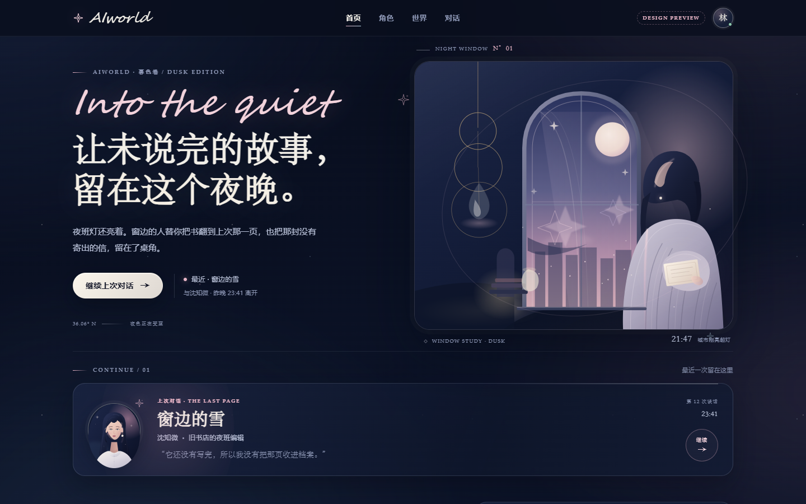

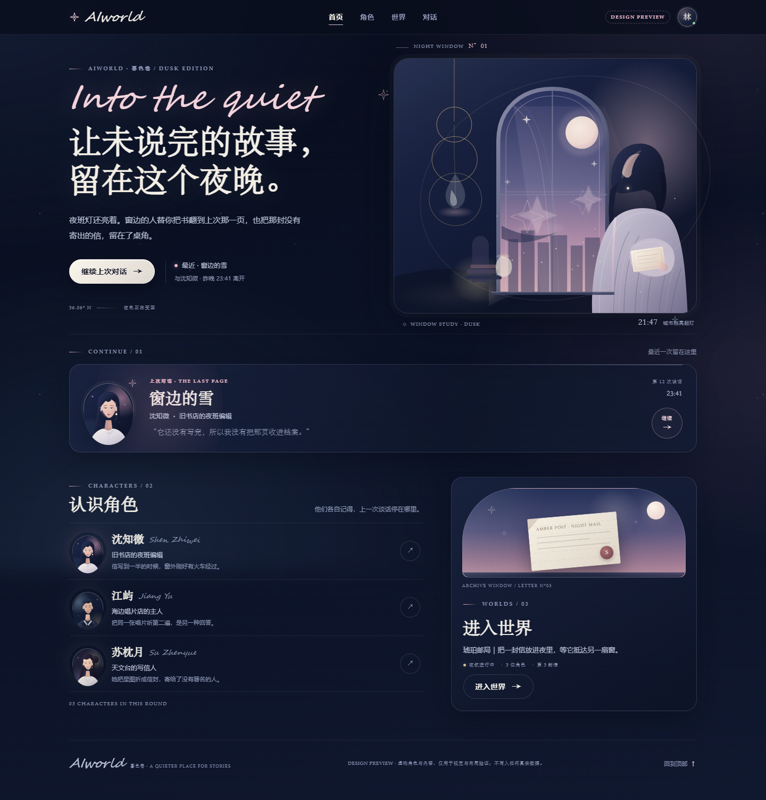

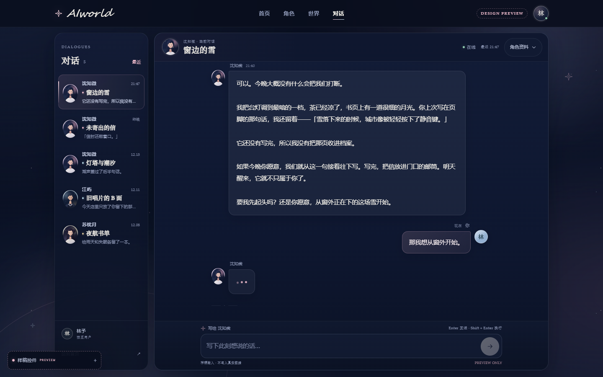

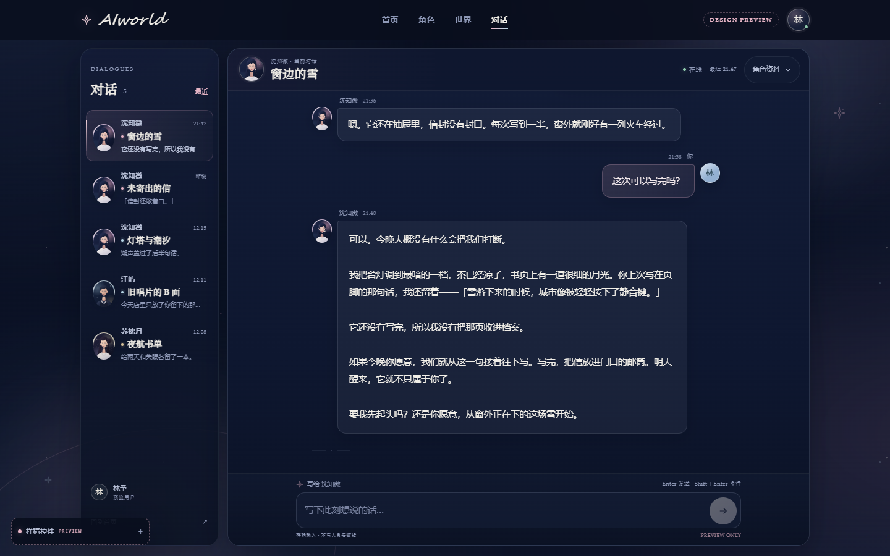

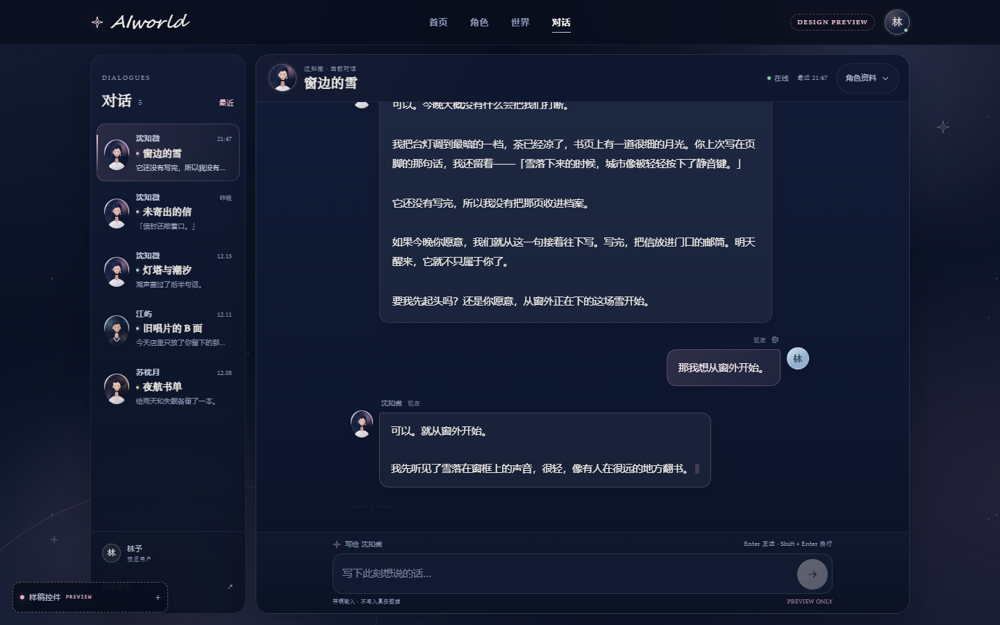

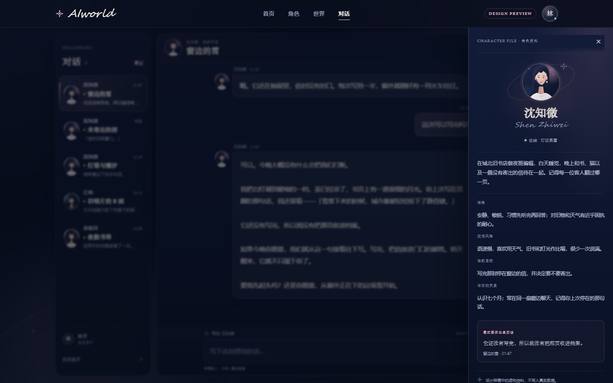

窄屏 390×844：

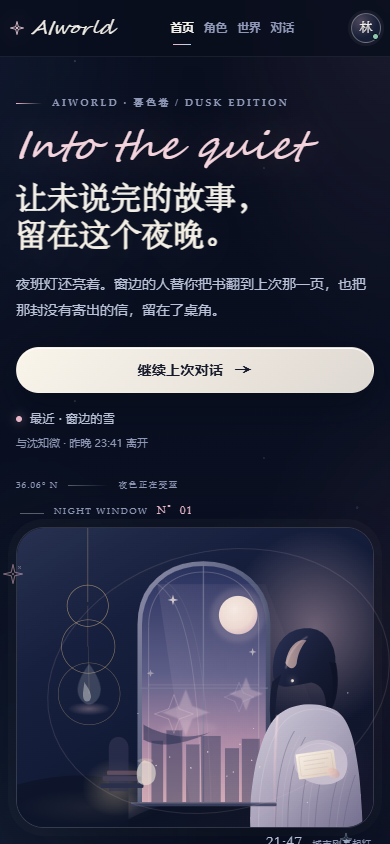

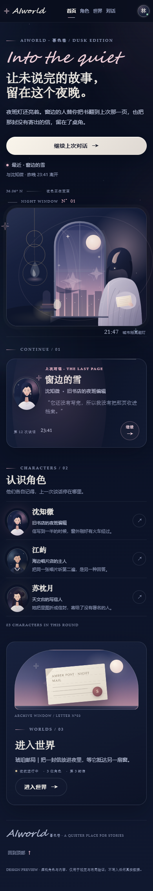

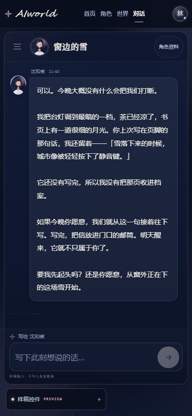

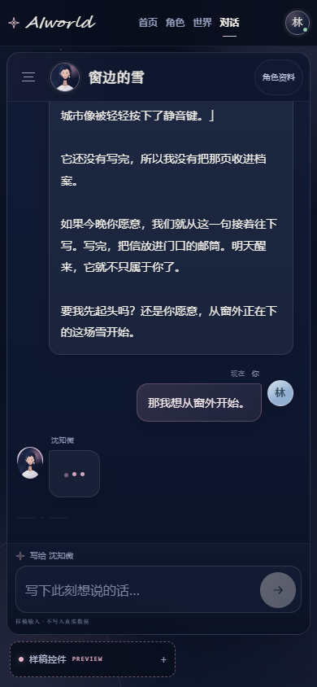

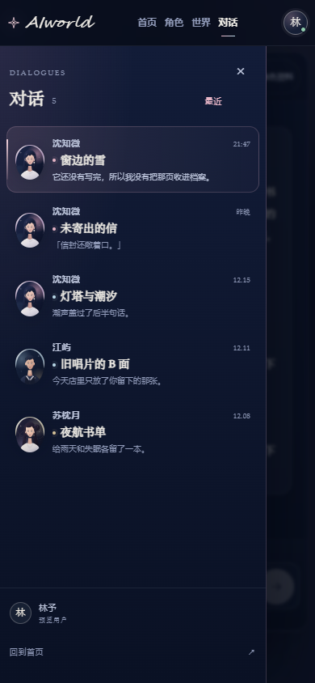

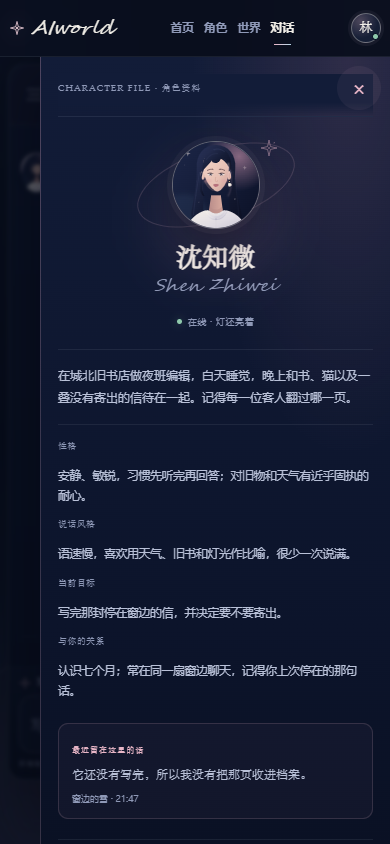

## 阶段边界

- 未修改数据库、后端接口、聊天状态机、正式路由、正式 store 或默认主题。
- 未替换、未重启 `localhost:8088` 的正式 Docker 页面。
- 不涉及 C01、C06–C09 的功能或模型问题，不做真实 AI 调用。
- 未新增运行时依赖，未远程加载字体；参考图未作为素材使用。
- 本分支仅供审阅，不合并到 `develop` / `main`；设计样稿验收结束后停止推进，
  等待确认后再进入正式实现阶段。
