# AIworld 浮光卷 / Dreamlight · 首页与聊天页设计样稿

本目录记录 v2 独立设计样稿「浮光卷 / Dreamlight」。它只验证视觉、布局和轻量交互，
不改造正式业务页面，不接入数据库、接口、正式 store 或真实 AI。样稿内角色、会话、
时间与引语全部为虚构内容。v1「暮色卷 / Dusk Edition」的评审目录仍保留在
`docs/design-preview/`，可供对比，不被本目录覆盖。

## 预览地址与启停

- 独立预览地址：<http://127.0.0.1:5199/>
  - 首页：<http://127.0.0.1:5199/#/home>
  - 聊天页：<http://127.0.0.1:5199/#/chat?session=tomato>
  - 会话参数：`tomato`（番茄的第一颗果）、`rain`（雨停之后）、`record`（唱针调到最轻）、
    `rooftop`（顶楼的风向）、`snack`（夜市的第二碗冰粉）
- 启动（在仓库根目录执行）：

  ```bash
  cd frontend
  npm run dev:design
  ```

- 停止：在运行该命令的终端按 `Ctrl+C`。本次验收期间 5199 预览保持运行；正式 Docker
  页面（`localhost:8088`）未改动、未重启。
- 预览入口使用独立 Vite 配置 `frontend/vite.preview.config.mjs`（root 为
  `frontend/preview`，端口固定 5199，产物为 `frontend/dist-design`），不加载正式应用的
  路由、Pinia store、API 客户端或 Element Plus 主题。

## 视觉方向

v1 被否定的核心是：大面积近黑深蓝、平面插画感、缺少材质/光/景深、像文学阅读工具。
v2 不是提亮或换色，而是重建：

- **底色**：暖珍珠灰页底，叠加极淡的冰蓝与玫瑰径向光；不使用近黑蓝大平面。
- **材质**：主视觉与头像使用原创静态位图，带丝绒反光、珍珠高光、金属环和柔焦层次；
  页面再叠加低透明度细颗粒、局部扩散光、轨道细线和小号注释。
- **文字**：中文展示标题用自托管 Noto Serif SC 600，正文用 Noto Sans SC；拉丁数字和
  注释用 Bodoni Moda，小面积英文手写体用 Pinyon Script。中文正文、按钮和输入不叠在
  复杂背景上，不做模糊或发光。
- **版式**：大/小字号对比、细曲线、发丝线、小面积复古拼贴/轨道符号；短消息收缩，
  长回复限宽，聊天页比首页安静。

## 三张参考的转化方式

三张参考图仅做风格分析，没有裁切、拼贴、嵌入、作为纹理或将任何像素用作背景。

1. **自由拼贴与图形/背景融合**：转化为全幅 hero 的遮罩式融合、半透明珍珠面板、
   轨道细线、细颗粒和页脚小注释；不使用参考图里的具体图形。
2. **摄影感场景 + 精致手写/高对比衬线**：转化为中文衬线大标题、小号 Bodoni 注释、
   Pinyon Script 小面积英文，以及大/小字号强对比；手写体采用已核验的 OFL 字体，
   不用普通系统手写字体。
3. **光照/色彩/氛围依据**：转化为蓝粉透光、丝绒/珍珠/金属材质、柔焦层深与局部高光；
   未复制其手、窗、构图或具体场景。

## 原创素材与许可（重要限制）

**本环境没有可用的图像生成模型/扩散图工具，也没有引入外部图片。** 因此没有把
低质量占位图当成最终主视觉，也没有悄悄改成另一套平面插画或耗时实时 3D 场景。
主视觉、世界带和四张角色头像均由本地程序化生成：

- 原始程序化位图：离线小型光线投射器 + Python/Pillow/NumPy 后期（柔光、调色、裁切、
  WebP 压缩），位于本地取证目录 `.acceptance-run/dream-preview/`（不提交）。
- 产物：`frontend/preview/assets/art/hero-dream.webp`（325.8 kB）、
  `world-dream.webp`（87.1 kB）、四张 900×900 头像（14–25 kB）、`grain-tile.png`。
- 这些是**程序化渲染的原创静态光材质样张，不是摄影作品**；它们提供材质、反光和景深，
  但不冒充真实摄影。若审阅要求真实摄影或更完整的视觉资产，需要进入有授权的图像生成/
  摄影素材环节，不应在本阶段用占位图充数。

字体均为本地自托管，无远程字体运行时；许可证文本位于
`frontend/preview/assets/fonts/licenses/`：

| 字体 | 用途 | 许可 |
| --- | --- | --- |
| Noto Serif SC 600 | 中文展示标题 | SIL OFL 1.1 |
| Noto Sans SC 400/500 | 中文正文与界面 | SIL OFL 1.1 |
| Bodoni Moda 400/600 | 拉丁展示、时间、小注释 | SIL OFL 1.1 |
| Pinyon Script 400 | 小面积英文手写体 | SIL OFL 1.1 |

## 复用与样稿专属

**复用且未改动的正式组件/逻辑**（位于 `frontend/src/`）：

| 文件 | 用途 |
| --- | --- |
| `components/ui/SimpleAvatar.vue` | 用户头像的首字母/颜色回退 |
| `components/chat/ChatSessionAvatar.vue` | 会话列表、消息和角色资料头像 |
| `utils/chatSessionPresentation.js` | 通过模拟 session 形状解析角色/用户展示信息 |

**样稿专属**（全部在 `frontend/preview/`）：

- `App.vue`、`router.js`、`index.html`、`main.js`
- `views/HomeView.vue`、`views/ChatView.vue`
- `components/PreviewTopNav.vue`、`SessionRail.vue`、`ProfilePanel.vue`、
  `PreviewDock.vue`、`DuskStar.vue`
- `preview.scss`、`data.js`
- `assets/art/*`、`assets/fonts/*`
- 独立配置：`frontend/vite.preview.config.mjs`；脚本：`dev:design` / `build:design`

`SceneWindow.vue` 保留自 v1，但 v2 页面不再引用；它不会进入 v2 渲染树。

## 首页

- 全幅 hero 由视觉焦点图像自然融入左侧文字，不使用“左标题 + 硬边框右插画卡”。
- 标题固定为两行、按语义断行，不会拆开“故事”等词，也不会出现孤字成行。
- “继续上次”是一条紧凑的会话按钮（阿梨 / 番茄的第一颗果），不是巨大欢迎卡；
  下方仍保留四个不同气质的角色入口和“微光街区”世界入口。
- hero 高度受控：1440×900 首屏在 y≈677 出现“四种脾气，四张门”标题和首批角色卡。
- 文案覆盖植物、旧书、唱片、气象、夜市等不同生活内容，不绑定雪夜、信件与忧郁。
- 世界入口是样稿内的说明按钮，点击只显示“世界页不属于本阶段交付范围”，不伪装为
  已完成的正式页面。

## 聊天页

- 与首页共享珍珠光材质与字体，但阅读面更安静：暖珍珠灰、低透明晕光，不是近黑蓝块，
  也不是刺眼纯白。
- 236px 会话栏（≤960px 改为抽屉）、720px 阅读列、628px 长消息限宽；会话标题、话题、
  时间与摘要可区分。
- 短消息自然收缩；长回复按`\n`保留段落换行，并把多余空行压缩为单换行，行高收紧到
  1.72（桌面）/1.74（窄屏），减少过长留白。
- 等待态只在角色头像旁显示三点动画，没有“等待 AI 回复”等重复系统文案；生成态在
  气泡尾部显示光标。
- 角色资料默认收起；输入区为紧凑的 46–128px 自适应文本域；装饰只在边缘/局部。
- 390px 下汉堡抽屉、输入增高和滚动均可用；样稿控件位于预留底带，不覆盖输入区。

## 交互与可访问性

- 状态按钮具备 `aria-pressed`；导航具备 `aria-current`；面板开关具备
  `aria-expanded`；抽屉/资料面板的遮罩有标签，打开后焦点进入关闭按钮，`Esc` 可关闭。
- 主要交互目标 ≥44px，保留 `:focus-visible` 冰蓝描边；输入焦点由整条 composer
  聚焦态提示，不再在文本域内画一圈生硬方框。
- 支持 `prefers-reduced-motion`（三点/光标/抽屉动画关闭）与 `forced-colors`
  基础回退。
- 预览控件位于左下虚线面板，与产品操作区分；窄屏不遮挡输入。
- `长回复` 样稿状态若当前会话没有长消息，会自动切到拥有长回复的阿梨会话，保证控件
  总能演示长回复。
- 输入只改本地组件状态：`Enter` 发送进入虚构等待态，`Shift + Enter` 换行；刷新即恢复
  虚构数据，不写真实数据。

## 实测范围

使用系统 Chrome（Playwright Core + `C:/Program Files/Google/Chrome/Application/chrome.exe`，
headless，DPR=1）逐页实际加载并截图：

| 视口 | 结果 |
| --- | --- |
| 1440×900 | 无横向溢出；无控制台/页面错误；hero 612px；继续卡 486×96；角色区从 y≈677 开始 |
| 1024×768 | 无横向溢出；hero 608px；继续卡可见；角色区从 y≈673 开始 |
| 390×844 | 无横向溢出；主导航单行；hero 图像 232px；标题 y≈387；角色区 y≈696 |
| 聊天 1440 | 房间 971×806；阅读列 720；composer 114px；长气泡 576×228 |
| 聊天 1024 | 房间 735×674；阅读列 720；长气泡 578×228 |
| 聊天 390 | 房间 374×716；阅读列 363；长气泡 300×331；三行输入后输入区 111px |

逐张检查的实际结论：

- 页面已不再被近黑深蓝占满；主视觉、头像和世界带有可辨认的丝绒/金属/珍珠光与柔焦层深。
- 首页首屏有明确视觉焦点、可读的继续入口和下一段内容入口；标题中文断行自然。
- 聊天短消息、等待、生成与长回复都保持同一套光色语言；长回复仍可读，但已收紧间距。
- 四类角色内容（植物、旧书、唱片、气象）使用同一视觉系统，不依赖单一“雪夜/信”语气。
- 窄屏抽屉、输入增长和底带样稿控件无遮挡。
- 它仍是程序化光材质样张，不是真实摄影；这是本环境素材工具缺失下的明确限制。

## 测试与构建

- `cd frontend && npm test`：342 passed / 0 failed（Node 内置 test runner）。
- `npm run build:design`：成功；53 modules，1.27s；CSS 68.50 kB，JS 133.25 kB；
  主视觉 325.83 kB；仅 Sass legacy JS API 弃用警告。
- 正式回归 `npm run build`：成功；1816 modules，7.10s；保留原有的
  `AvatarCreate` / `index` 大 chunk 体积警告与 Sass legacy API 警告；正式产物未引入
  预览页面或预览字体。

## 截图

桌面 1440×900：

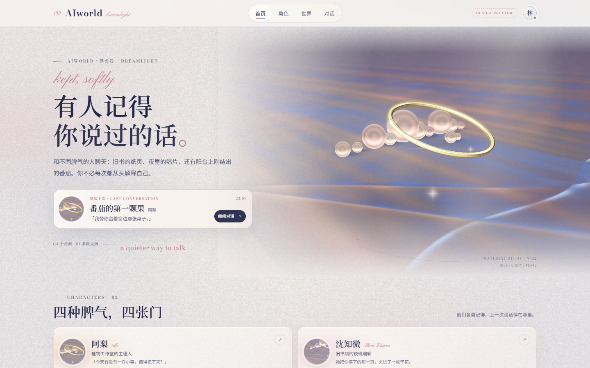

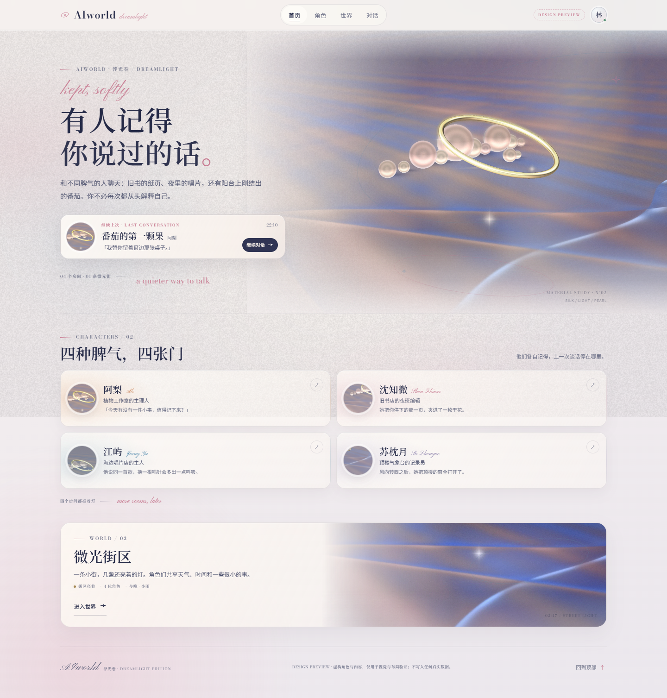

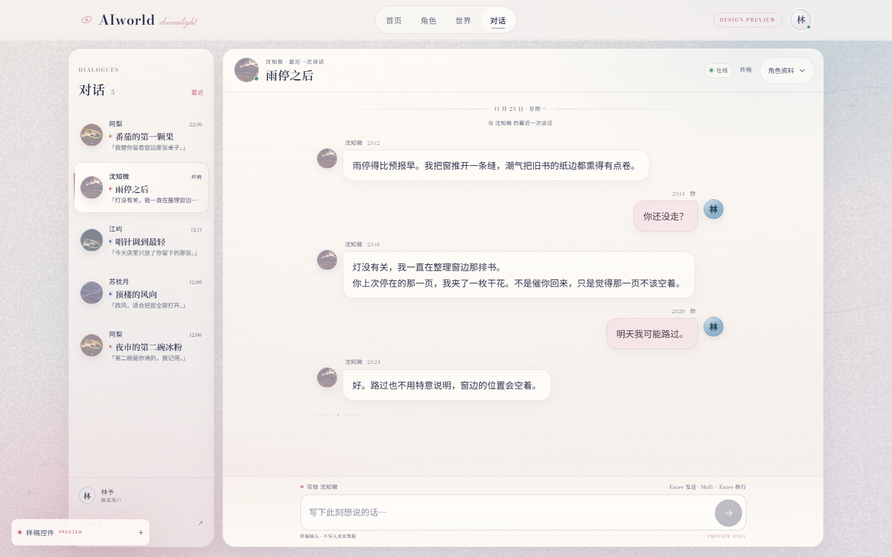

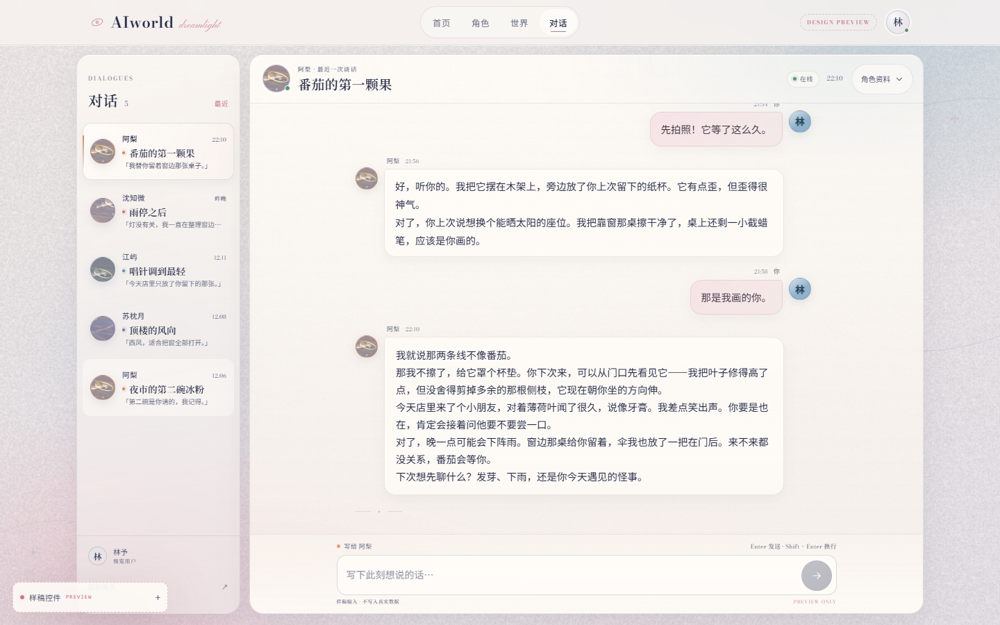

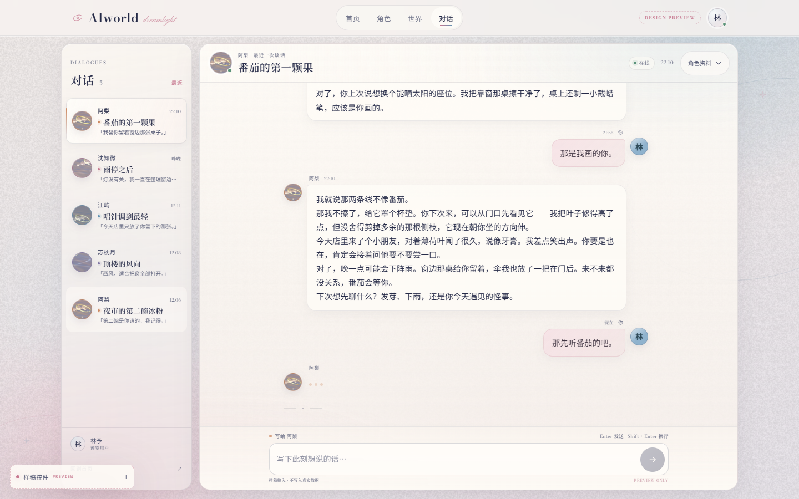

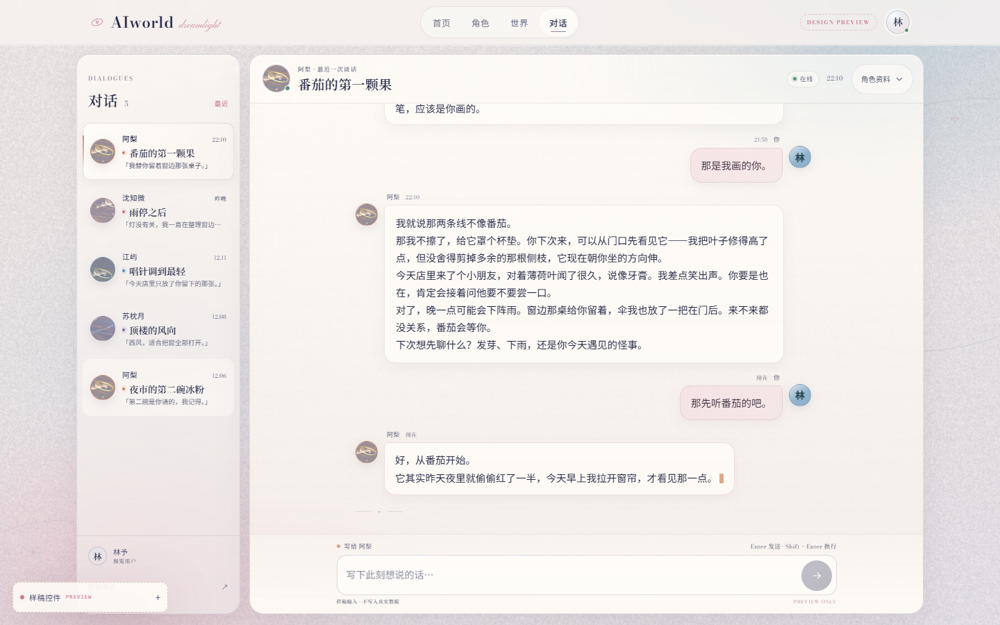

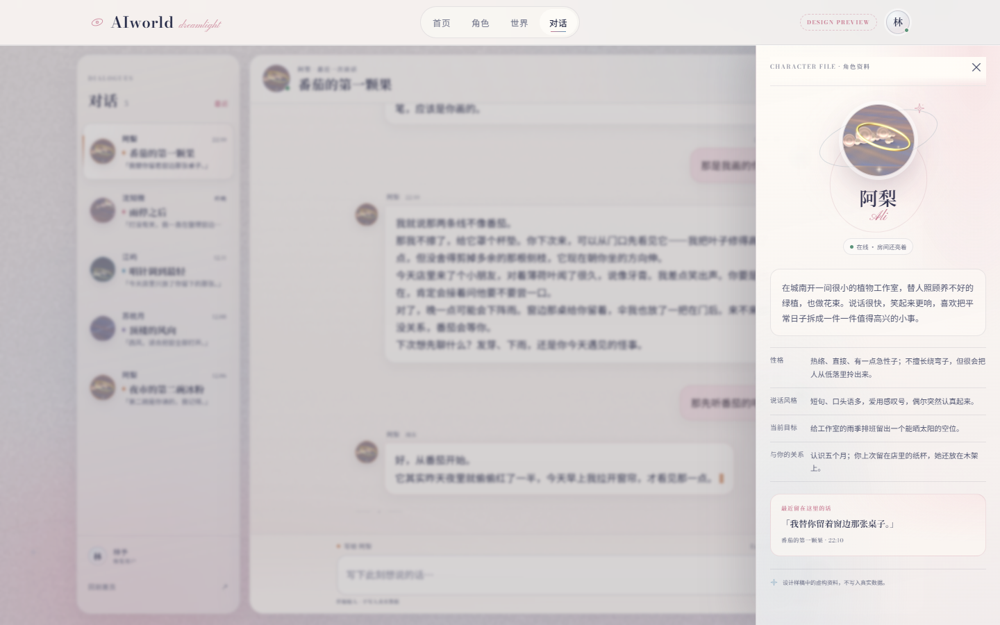

中间宽度 1024×768：

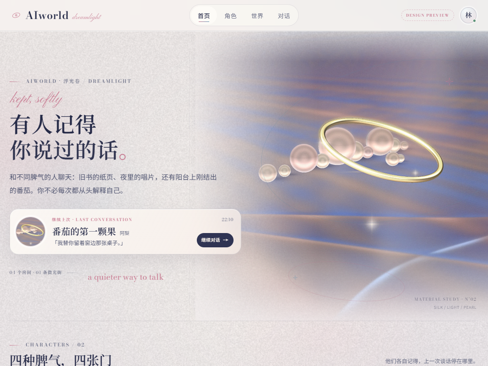

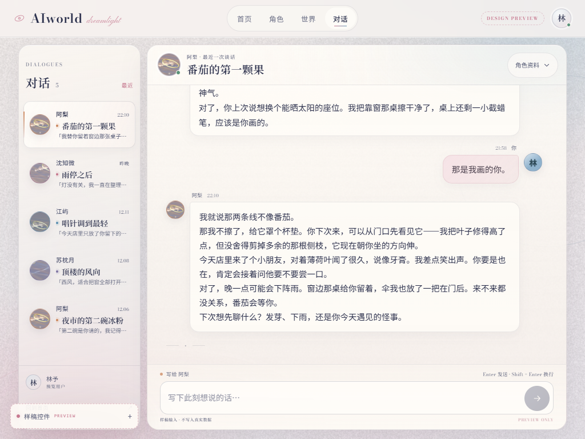

窄屏 390×844：

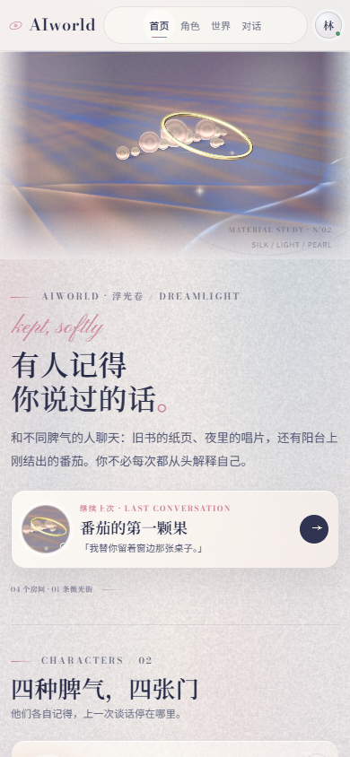

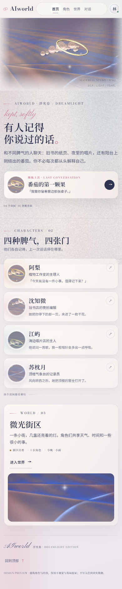

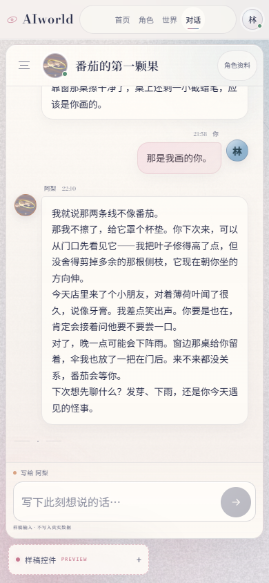

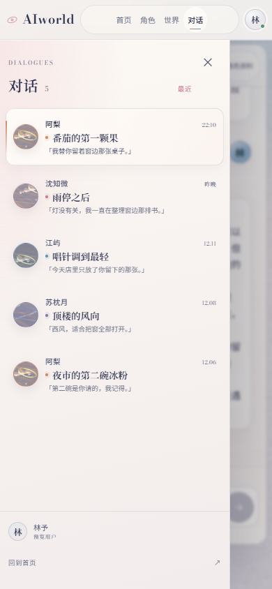

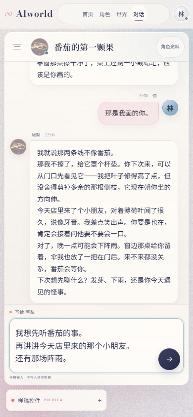

## 阶段边界与遗留限制

- 未修改数据库、后端接口、正式聊天状态机、正式路由、正式 store 或默认主题。
- 未替换、未重启 `localhost:8088` 的正式 Docker 页面；未改动 C01、C06–C09。
- 未做真实 AI 调用；样稿数据、角色、会话全部为本地虚构。
- 主视觉为程序化原创位图，不是摄影；如需真实摄影/更高质量生成素材，需另行授权与工具。
- 本次设计仅提交独立预览分支，不合并 `develop` / `main`，不创建合并 PR；等视觉确认后
  再讨论是否迁移至正式页面。
